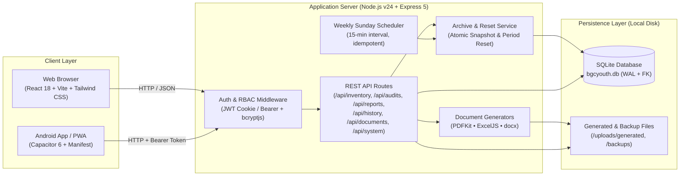
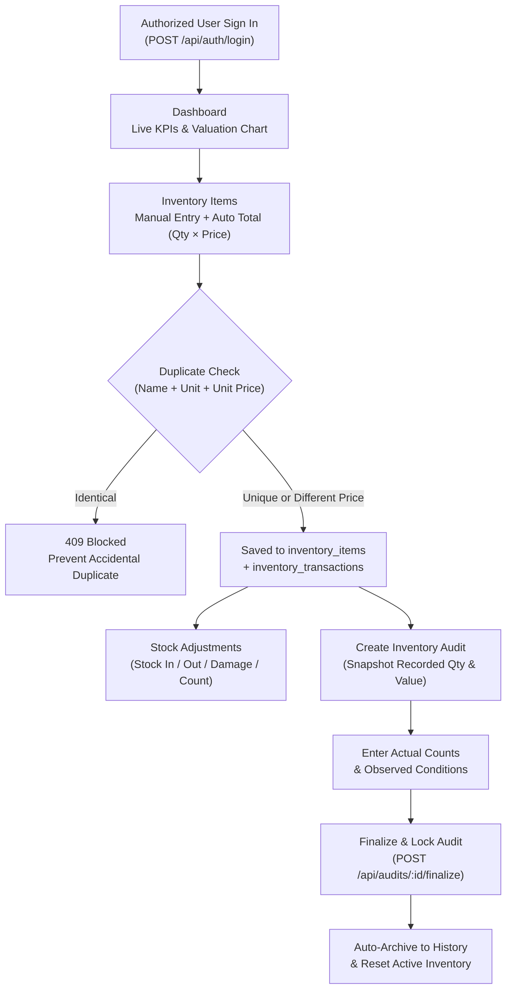
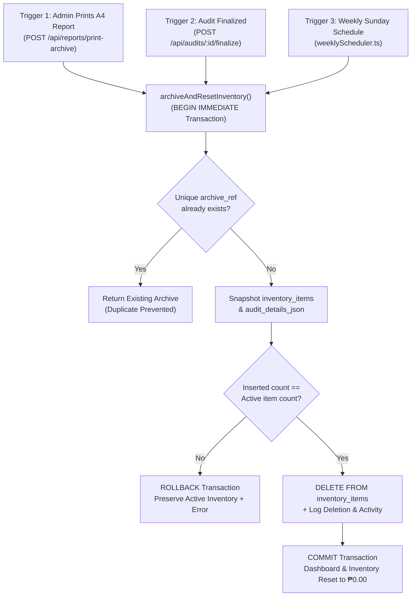
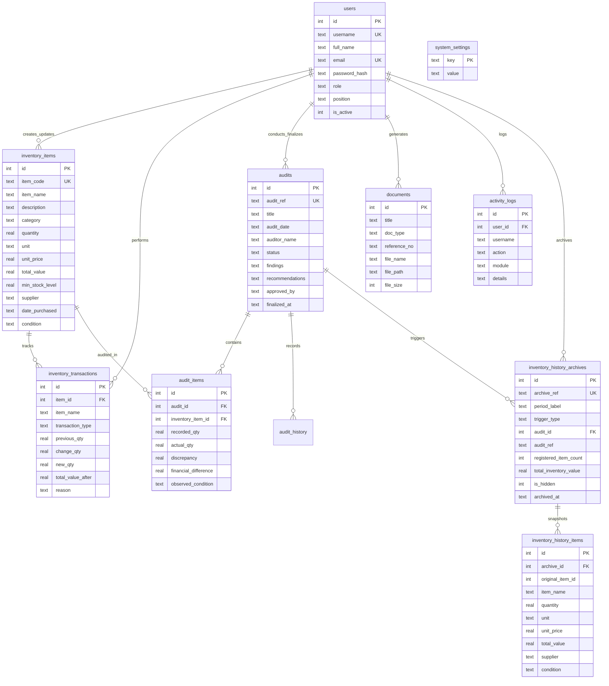

# BGCyouth — Butuan Gospel Church Youth Inventory & Auditing System

A full-stack, database-integrated **Inventory, Auditing, Automated History Archiving, and Financial Reporting System** built for **Butuan Gospel Church Youth Ministry (BGCyouth)**. Designed with a formal, responsive UI, Philippine Peso (`₱`) currency formatting, role-based access control (RBAC), atomic SQLite transactions, editable Word (`.docx`) / PDF / Excel (`.xlsx`) exports, and Android APK / PWA support.

---

## System Architecture & Network Topology



---

## End-to-End System Flowcharts

### 1. Inventory & Auditing Lifecycle



### 2. Automated Inventory Reset & History Archiving Flow



---

## Entity-Relationship Diagram (ERD)



---

## Core Features & Modules

1. **Dashboard (`/`):** Live SQLite-backed KPIs (`Registered Items`, `Inventory Value`, `Completed Audits`, `Pending Audits`), Recharts **Inventory Valuation Overview**, **Recent Activity**, and **Recently Registered Items**.
2. **Inventory Items (`/inventory`):** Manual item registration (no prefilled fake data), automatic `total_value = quantity × unit_price`, price-aware duplicate blocking (same item allowed at different unit prices; identical name + unit + price blocked), search, condition filtering, sorting, CSV export, stock adjustments, and transaction history.
3. **Inventory Audits (`/audits`, `/audits/:id`):** Physical count verification, automatic discrepancy & financial variance (`₱`) calculation, findings/recommendations, irreversible **Finalize & Lock** (`403` protection), optional inventory reconciliation, and automatic History archiving on completion.
4. **Reports & Financial Summary (`/reports`):** Official A4 print layout with **Butuan Gospel Church • BGC Youth Ministry** letterhead, **Church Board** signatory block, **Export Word (`.docx`)**, **Download PDF**, **Export Excel (`.xlsx`)**, and **Print A4** (automatically archives & resets active inventory for Administrators).
5. **History Archives (`/history`):** Independent historical snapshots organized by date, period, and activity trigger (`Print Report`, `Audit Completed`, `Weekly Sunday Reset`), with search, date/activity filters, expandable item tables, **Hide/Unhide** from default view, and **Permanent Delete** (Admin only).
6. **Document Center (`/documents`):** Centralized archive of all generated PDF, Word (`.docx`), and Excel (`.xlsx`) exports with search, type filter, preview, download, and Admin delete.
7. **System Administration (`/logs`, `/users`, `/backup`, `/settings`):**
   - **Activity Logs:** Full audit trail of logins, inventory changes, audits, exports, and resets.
   - **User Accounts:** Role-based access control (`admin`, `auditor`, `staff`, `viewer`).
   - **Backup & Recovery:** SQLite `PRAGMA integrity_check`, live `.db` snapshots (`VACUUM INTO`), and verified restore.
   - **Settings:** Profile editing, password change, organization & report defaults (`system_settings`), and personal activity log.

---

## Tech Stack

- **Frontend:** React 18, TypeScript, Vite 6, Tailwind CSS, React Router v6, Lucide Icons, Recharts, Sonner
- **Backend:** Node.js v24 (`node:sqlite`), Express 5, TypeScript, JWT (`jsonwebtoken`) + `bcryptjs`, Helmet, PDFKit, ExcelJS, `docx`
- **Mobile / Offline Shell:** Capacitor 6 (`c:/BGCyouth/client/android`) + Web App Manifest (`PWA`)

---

## Setup, Build & Run

### 1. Install Dependencies
```powershell
npm --prefix server install
npm --prefix client install
```

### 2. Build Production Bundles
```powershell
npm run build
```

### 3. Start the Application
```powershell
npm start
```
Open `http://localhost:4000` in your browser.
- **Initial Administrator Account** (created automatically only when `users` is empty):
  - **Username:** ``
  - **Password:** ``
  - *(Change the password after your first sign-in under **Settings → Security & Password**.)*

### 4. Android APK Sync
To sync updated web assets into the Capacitor Android project (`c:/BGCyouth/client/android`):
```powershell
npm run apk:sync
```
Open `c:/BGCyouth/client/android` in **Android Studio** and run **Build → Build Bundle(s) / APK(s) → Build APK(s)**.
